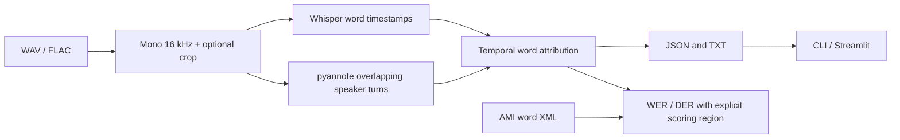

# Meeting Speech Lab

A local, modular speech recognition and speaker diarization pipeline for the AMI Meeting Corpus. OpenAI Whisper produces word timestamps; pyannote Community-1 detects speaker activity, including overlaps. A CLI and Streamlit dashboard share the same Python API.

**Status:** locally tested implementation with successful real ASR, diarization, and AMI evaluation on a 60-second crop. Full-meeting validation is in progress. No production-readiness claim is made. See [PROGRESS.md](PROGRESS.md).



## Setup

Python 3.11–3.13; Apple Silicon supported. Python 3.13 is used for local validation. First inference downloads pretrained weights; allow disk space and network access. No paid OpenAI API key is needed.

```bash
cd ~/Projects/whisper-asr-speaker-diarization
python3 -m venv .venv
source .venv/bin/activate
pip install -r requirements.txt
cp .env.example .env
```

For an exact recreation of the validated Mac environment, use `pip install -r requirements-macos-py313.lock` before `pip install -e . --no-deps`. This platform-specific snapshot does not promise cross-platform wheel availability. CI resolves project dependencies on Linux.

Accept the [Community-1 access conditions](https://huggingface.co/pyannote/speaker-diarization-community-1), then set `HF_TOKEN` in `.env` to a read token. Tokens are never serialized in transcripts and `.env` is ignored. Do not put tokens in command arguments or commit them. Missing authentication yields an actionable error; `--asr-only` runs without diarization.

The loader uses SoundFile and SciPy directly, avoiding an external audio decoder for WAV/FLAC inputs. Upstream Whisper's standalone file-path API requires FFmpeg, but this pipeline passes a decoded waveform. Pyannote may warn about optional TorchCodec/FFmpeg support; preloaded waveform input bypasses that decoder.

## Run

```bash
meeting-asr ~/Downloads/amicorpus/ES2002a/audio/ES2002a.Mix-Headset.wav \
  --duration 60 --output outputs/preview
# Without Hugging Face access:
meeting-asr ~/Downloads/amicorpus/ES2002a/audio/ES2002a.Mix-Headset.wav \
  --model tiny.en --duration 30 --asr-only --output outputs/asr-preview
streamlit run src/meeting_asr/dashboard.py --server.address 127.0.0.1
```

Omit `--duration` for the full meeting. `--start` selects an offset in seconds. JSON/TXT timestamps are relative to the crop; JSON metadata records the source offset and duration. Output directories are ignored by Git. Use distinct output directories per run. The dashboard processes only the requested preview duration and provides timeline and transcript downloads. AMI evaluation accepts a local annotation directory; it is intended for trusted local use, not public deployment.

## Apple Silicon

On the validated 8 GB M2 host, run inference jobs sequentially to avoid memory pressure. Release failed MPS allocations before CPU retry. Start with short crops before a full meeting.

`ASR_DEVICE=auto` selects CUDA, MPS, then CPU. Whisper uses float32 on MPS and CPU; unsupported MPS runtime operations retry on CPU and record the actual device. `DIARIZATION_DEVICE=cpu` is the conservative default; set `mps` to try acceleration with the same fallback. Model downloads and unrelated CPU/CUDA failures are not silently retried. Larger Whisper models increase memory and latency; start with `base.en`. There is no claim that MPS is faster for every model or meeting.

## AMI annotations and evaluation

For the dataset already on this Mac, the verified paths are:

```bash
meeting-asr ~/Downloads/amicorpus/ES2002a/audio/ES2002a.Mix-Headset.wav \
  --annotations ~/Downloads/ami_public_manual_1.6.2 --meeting ES2002a \
  --output outputs/ES2002a-full
```


Download [AMI manual annotations v1.6.2](https://groups.inf.ed.ac.uk/ami/download/) and extract them under ignored `data/ami/`. The validated archive SHA-256 is `b56e5babb2496b8795deeeda7e71178d7fbc9963f94276cf2a3f4b56ebbc9f9d`. Preserve the extracted `words/` and `segments/` files. Audio and annotations are distributed by AMI under CC BY 4.0; retain their attribution and license. Supply the directory containing the extracted `words/` tree:

```bash
meeting-asr ~/Downloads/amicorpus/ES2002a/audio/ES2002a.Mix-Headset.wav \
  --annotations data/ami --meeting ES2002a --duration 60 --output outputs/evaluated
```

Missing annotations never generate placeholder scores. WER uses JiWER after lowercasing and stripping punctuation, preserving word-internal apostrophes. Reference words are sorted by timestamp; overlapping references are serialized in that order. This is plain WER, **not** speaker-attributed WER or permutation-invariant multi-speaker ASR scoring. Whisper can miss one voice in an overlap; detecting overlap does not recover that voice's text.

DER uses pyannote.metrics' optimal speaker mapping, with missed speech, false alarms, and confusion. Default collar is 0 seconds and overlap is included. `--collar 0.25` or `--skip-overlap` explicitly changes the protocol and is recorded. The scoring region is exactly the decoded crop, including silence. Reference words are selected by midpoint; DER activity is clipped to the region. Midpoint selection at a crop boundary can affect WER.

DER reference activity uses AMI `segments/*.segments.xml` transcriber start/end times, preserving overlapping speakers. Both words and segments must be available for each speaker. The Python loader also supports explicitly requested lexical-word activity for exploratory use. Scores on a crop of one headset mix are not directly comparable with published multi-meeting AMI benchmark results: splits, microphone channels, and scoring regions must match first.

Alignment ranks all speakers whose activity intersects each word by total intersection duration. `overlap=true` requires actual simultaneous activity from different speakers, rather than merely crossing a turn boundary. Empty matches become `UNKNOWN`. Multiple candidates express uncertainty, not a claim that every candidate spoke that word. Speaker IDs are session-local, not personal identities.

## Accuracy experiments

```bash
meeting-asr ~/Downloads/amicorpus/ES2002a/audio/ES2002a.Mix-Headset.wav \
  --annotations data/ami --duration 60 --experiment --speakers 4 \
  --output outputs/experiments
```

The runner compares `base.en` with automatic speaker count, `small.en` with automatic count, and `small.en` with a known count (default 4 for this AMI meeting). It writes separate artifacts and a comparison JSON only from actual model output. `--prompt` supports domain vocabulary; all runs record its value, so avoid sensitive prompt text. Known counts use prior information and must be disclosed. These are experiment hypotheses, not guaranteed improvements. Tune on development meetings and report held-out meetings before claiming general gains.

## Verified local results

Local validation on Apple Silicon, Python 3.13, PyTorch 2.8.0: 19 tests passed; Ruff lint and formatting passed; `pip check` passed. Both tested Whisper models attempted MPS and completed through the CPU fallback. Model quality below is measured against AMI v1.6.2 word annotations, using the normalization described above.

| ES2002a crop | Reference words | Whisper | WER | Substitutions / deletions / insertions |
|---|---:|---|---:|---|
| 30–60 seconds | 14 | tiny.en | 107.14% | 3 / 2 / 10 |
| 30–60 seconds | 14 | base.en | 121.43% | 3 / 3 / 11 |
| 60–120 seconds | 144 | tiny.en | 22.92% | 16 / 14 / 3 |
| 60–120 seconds | 144 | base.en | 23.61% | 16 / 14 / 4 |

The larger model did not improve these samples. WER can exceed 100% when insertions are numerous. These are two crops of one meeting, not held-out corpus benchmarks. The table contains ASR-only comparisons; DER is unavailable for those runs. Synthetic DER tests verify metric behavior, not model performance. After model access was granted and checkpoint compatibility was fixed, the full CLI pipeline on seconds 60–120 measured **13.14% DER**, with zero collar and overlap included, against AMI transcriber speech segments. It detected three session-local speakers and one word intersecting simultaneous speaker activity.

The optional TorchCodec binary installed by upstream pyannote is incompatible with this environment's PyTorch binary. The waveform adapter bypasses that decoder, and its API is covered by tests; real waveform-based pyannote inference succeeded. The loader scopes an allowlist to the three known checkpoint metadata classes, following the [PyTorch restricted-loading API](https://docs.pytorch.org/docs/stable/notes/serialization); it does not enable unrestricted pickle loading.

## API and engineering

```python
from pathlib import Path
from meeting_asr.config import Config
from meeting_asr.pipeline import run, save

result = run(Path("meeting.wav"), Config(), duration=60)
save(result, Path("outputs/api"))
```

`audio`, `inference`, `alignment`, `evaluation`, and `pipeline` are independent modules. Immutable word/turn records and a serializable transcript boundary support future AI Interviewer integration. Models load lazily. The current batch API does not implement streaming, persistence, speaker identity enrollment, or concurrent job scheduling. Model instances are loaded per run; a future service should manage a bounded model pool.

```bash
ruff check .
ruff format --check .
pytest -q
```

Tests use synthetic audio/references and mocked model adapters; optional metric and dashboard tests run when their dependencies are installed. CI checks formatting, lint, and tests on Python 3.11 and 3.13 without credentials or model downloads. Real model inference is a separate, explicitly recorded smoke check. Do not interpret synthetic test accuracy as AMI performance.

## Data hygiene

Datasets, recordings, model weights, virtual environments, generated outputs, and secrets are ignored. Audio is processed locally, but model acquisition contacts model hosts. Transcripts may contain sensitive meeting content: choose output locations and retention deliberately. The dashboard should remain bound to localhost. No dataset or generated transcript is included in this repository.

## Sources

- [OpenAI Whisper](https://github.com/openai/whisper)
- [pyannote Community-1 model card and API](https://huggingface.co/pyannote/speaker-diarization-community-1)
- [AMI corpus and annotations](https://groups.inf.ed.ac.uk/ami/corpus/)
- [pyannote.metrics](https://github.com/pyannote/pyannote-metrics)
